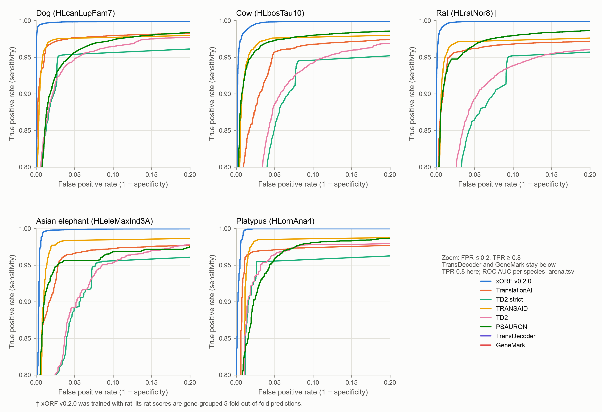

<p align="center">
  <p align="center">
    
  </p>

  <p align="center">
    
  </p>

  <span>
    <h1 align="center">
        orfarena
    </h1>
  </span>

  <p align="center">
    <a href="https://github.com/hillerlab/orfarena" reference="_blank">
      
    </a>
  </p>

  <p align="center">
    <samp>
        <span> benchmark ORF prediction methods </span>
        <br>
        <span> The Hiller Lab at the Senckenberg Research Institute </span>
        <br>
        <br>
        <a href="https://en.wikipedia.org/wiki/Open_reading_frame">orf</a> .
        <a href="https://github.com/hillerlab/orfarena/blob/main/assets/pipeline/orfarena.mermaid">pipeline</a> .
        <a href="https://hillerlab.com/">us</a> 
    </samp>
  </p>

</p>

---

## Arena

One-shot RefSeq/TOGA2-derived annotations of five genomes. Positives are the annotated coding transcripts; a tool finds one when it predicts exactly its annotated CDS at or above the tool's threshold. Negatives are lncRNA transcripts without repeats; a tool calls one when it predicts any ORF on it at or above the threshold. Thresholds are each tool's default: xORF v0.2.0 its model cutoff (0.294), TRANSAID 0.635, the others 0.5. ROC AUC and average precision do not depend on the threshold.

Dog genome (ROSCfam1.0, HLcanLupFam7): 25,235 coding transcripts, 16,453 lncRNAs.

| Tool | Threshold | TP ↑ | TN ↑ | FP ↓ | FN ↓ | Sensitivity ↑ | Specificity ↑ | F1 ↑ | Balanced accuracy ↑ | ROC AUC ↑ | Average precision ↑ |
| :--- | ---: | ---: | ---: | ---: | ---: | ---: | ---: | ---: | ---: | ---: | ---: |
| **[xORF v0.2.0](https://github.com/hillerlab/xorf)** | 0.294 | **24,854** | **16,432** | **21** | **381** | **0.9849** | **0.9987** | **0.9920** | **0.9918** | **0.9993** | **0.9996** |
| [TranslationAI](https://github.com/rnasys/TranslationAI) | 0.500 | 24,256 | 16,253 | 200 | 979 | 0.9612 | 0.9878 | 0.9763 | 0.9745 | 0.9878 | 0.9918 |
| [TD2 strict](https://github.com/Markusjsommer/TD2) | 0.500 | 23,923 | 15,992 | 461 | 1,312 | 0.9480 | 0.9720 | 0.9643 | 0.9600 | 0.9717 | 0.9778 |
| [TRANSAID](https://github.com/wuzengding/TRANSAID) | 0.635 | 23,336 | 16,354 | 99 | 1,899 | 0.9247 | 0.9940 | 0.9589 | 0.9594 | 0.9861 | 0.9893 |
| [TD2](https://github.com/Markusjsommer/TD2) | 0.500 | 24,442 | 14,365 | 2,088 | 793 | 0.9686 | 0.8731 | 0.9443 | 0.9208 | 0.9794 | 0.9856 |
| [PSAURON](https://github.com/salzberg-lab/PSAURON) | 0.500 | 24,775 | 13,688 | 2,765 | 460 | 0.9818 | 0.8319 | 0.9389 | 0.9069 | 0.9846 | 0.9908 |
| [TransDecoder](https://github.com/TransDecoder/TransDecoder) | 0.500 | 17,935 | 13,394 | 3,059 | 7,300 | 0.7107 | 0.8141 | 0.7759 | 0.7624 | 0.7997 | 0.8157 |
| [GeneMark](http://topaz.gatech.edu/GeneMark/license_download.cgi) | 0.500 | 16,467 | 13,662 | 2,791 | 8,768 | 0.6525 | 0.8304 | 0.7402 | 0.7415 | 0.7723 | 0.8385 |

All five genomes. Every metric for every genome and tool: [`assets/benchmark/arena.tsv`](assets/benchmark/arena.tsv).

| Genome | Coding transcripts | lncRNAs |
| :--- | ---: | ---: |
| Dog (HLcanLupFam7) | 25,235 | 16,453 |
| Cow (HLbosTau10) | 23,822 | 6,066 |
| Rat (HLratNor8)† | 29,277 | 12,716 |
| Asian elephant (HLeleMaxInd3A) | 22,956 | 2,917 |
| Platypus (HLornAna4) | 10,542 | 2,411 |

ROC AUC:

| Tool | Dog | Cow | Rat† | Asian elephant | Platypus |
| :--- | ---: | ---: | ---: | ---: | ---: |
| xORF v0.2.0 | **0.9993** | **0.9982** | **0.9990** | **0.9986** | **0.9990** |
| TranslationAI | 0.9878 | 0.9769 | 0.9799 | 0.9810 | 0.9831 |
| TD2 strict | 0.9717 | 0.9478 | 0.9550 | 0.9589 | 0.9704 |
| TRANSAID | 0.9861 | 0.9843 | 0.9827 | 0.9879 | 0.9855 |
| TD2 | 0.9794 | 0.9578 | 0.9619 | 0.9672 | 0.9805 |
| PSAURON | 0.9846 | 0.9894 | 0.9878 | 0.9841 | 0.9854 |
| TransDecoder | 0.7997 | 0.7996 | 0.8067 | 0.7597 | 0.7983 |
| GeneMark | 0.7723 | 0.6519 | 0.8427 | 0.8314 | 0.8424 |

F1 at the default thresholds:

| Tool | Dog | Cow | Rat† | Asian elephant | Platypus |
| :--- | ---: | ---: | ---: | ---: | ---: |
| xORF v0.2.0 | **0.9920** | **0.9908** | **0.9899** | **0.9938** | **0.9955** |
| TranslationAI | 0.9763 | 0.9703 | 0.9701 | 0.9750 | 0.9764 |
| TD2 strict | 0.9643 | 0.9601 | 0.9530 | 0.9704 | 0.9732 |
| TRANSAID | 0.9589 | 0.9622 | 0.9504 | 0.9673 | 0.9639 |
| TD2 | 0.9443 | 0.9592 | 0.9342 | 0.9753 | 0.9785 |
| PSAURON | 0.9389 | 0.9706 | 0.9601 | 0.9738 | 0.9615 |
| TransDecoder | 0.7759 | 0.7799 | 0.7938 | 0.8004 | 0.7469 |
| GeneMark | 0.7402 | 0.7657 | 0.8041 | 0.7845 | 0.7994 |

<p align="center">
  
</p>

ROC curves per genome, full range and zoomed: [dog](assets/benchmark/roc/HLcanLupFam7.png) · [cow](assets/benchmark/roc/HLbosTau10.png) · [rat](assets/benchmark/roc/HLratNor8.png) · [Asian elephant](assets/benchmark/roc/HLeleMaxInd3A.png) · [platypus](assets/benchmark/roc/HLornAna4.png) (SVG next to each PNG).

† xORF v0.2.0 was trained with rat. Its rat scores are out-of-fold predictions from gene-grouped 5-fold cross-validation.

- **xORF scores.** Dog comes from an xORF v0.2.0 run. Cow, elephant and platypus apply the v0.2.0 model to the candidate tables of xORF 0.1.x runs; the candidate steps are unchanged, and the scores equal v0.2.0's within 3e-8.
- **Other tools.** Their predictions are those of orfarena v0.0.1, scored against the current datasets. 13–72 transcripts per genome have left the coding sets since then.
- **Reproduce.** `python assets/benchmark/arena.py` rebuilds the table and the figures from the per-transcript scores in `assets/benchmark/scores/`.

---

## Usage

> [!NOTE]
> Requirements: Nextflow ≥ 25.04.6, Docker or Apptainer, Java.

```bash
git clone https://github.com/hillerlab/orfarena.git
cd orfarena
```

Edit `params.json` (set `genome`, `bed`), then:

```bash
# Docker
nextflow run main.nf -params-file params.json -profile docker

# Apptainer / Singularity
nextflow run main.nf -params-file params.json -profile apptainer
```

Smoke test:
```bash
nextflow run main.nf -profile test,apptainer
```

> [!NOTE]
> You can also specify these options directly in `params.json`.

---

## Output

```
results/
├── transdecoder/      *.bed
├── genemarkst/        *.bed
├── td2/               *.bed
├── td2_strict/        *.bed
├── psauron/           *.bed
├── gstama/            *.bed
└── pipeline_info/     timeline, trace, DAG
```

---

## Where to edit

| File | What |
|------|------|
| `params.json` | Paths, settings, checkpoints — per run |
| `nextflow.config` | Compute resources, profiles, container, SLURM — rarely |
